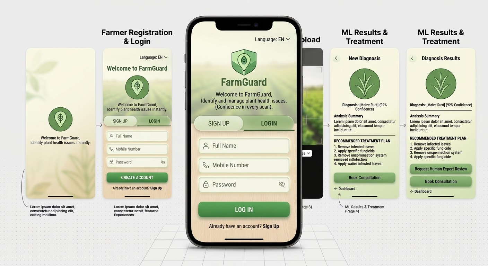

# 🌿 FarmGuard: Plant Disease Diagnostic App

> Empowering farmers with instant, AI-driven plant health diagnostics right from their fields. Confidence in every scan.



---

## 📖 About The Project

**FarmGuard** is a mobile application built with React Native that allows farmers to identify plant diseases quickly and accurately. By simply snapping a picture of a problematic leaf or stem, the image is sent to a Machine Learning backend, which analyzes the crop and returns a precise diagnosis along with an actionable treatment plan. 

Our goal is to reduce crop loss, increase yields, and make expert agricultural knowledge accessible to every farmer via their smartphone.

## ✨ Key Features

*   🔐 **Simple Authentication:** Easy-to-use registration and login tailored for farmers, requiring minimal input (Full Name, Email/Mobile, Password).
*   📊 **Farmer's Dashboard:** A clean central hub to view recent diagnostic history and quickly launch a new scan.
*   📸 **Smart Image Capture:** Built-in camera and gallery upload capabilities with intuitive bounding-box guides for perfect photo framing.
*   🧠 **Instant ML Diagnosis:** Fast integration with a Machine Learning server to detect diseases with high confidence scores.
*   💊 **Actionable Treatment Plans:** Step-by-step recommended actions (e.g., specific fungicides, removal of infected leaves) to mitigate the disease.
*   👨‍🌾 **Expert Consultation:** One-tap access to book a consultation with a human agricultural expert for second opinions.

## 🛠️ Tech Stack

*   **Frontend:** [React Native](https://reactnative.dev/) & [Expo](https://expo.dev/)
*   **Language:** [TypeScript](https://www.typescriptlang.org/) / JavaScript
*   **Icons:** [Expo Vector Icons](https://docs.expo.dev/guides/icons/) (Feather)
*   **Routing:** React Navigation / Expo Router *(Update based on your exact setup)*
*   **Backend/ML:** *(Add your backend stack here, e.g., Python, Flask/FastAPI, TensorFlow/PyTorch)*

## 📱 Screens Overview

1.  **Onboarding & Auth:** Welcome screen, Sign Up, and Log In.
2.  **Dashboard:** Main hub with "Quick Diagnose" CTA and recent scan history.
3.  **Capture Page:** Camera UI with crop type selector.
4.  **Results Page:** Displays the uploaded image, ML confidence score, and detailed treatment instructions.

## 🚀 Getting Started

Follow these steps to set up the project locally on your machine.

### Prerequisites

*   Node.js (v16 or higher)
*   npm or yarn
*   Expo CLI installed globally (`npm install -g expo-cli`)
*   Expo Go app installed on your physical device (iOS/Android) OR a configured emulator/simulator.

### Installation

1. **Clone the repository:**
   ```bash
   git clone [https://github.com/your-username/farmguard.git](https://github.com/your-username/farmguard.git)
   cd farmguard